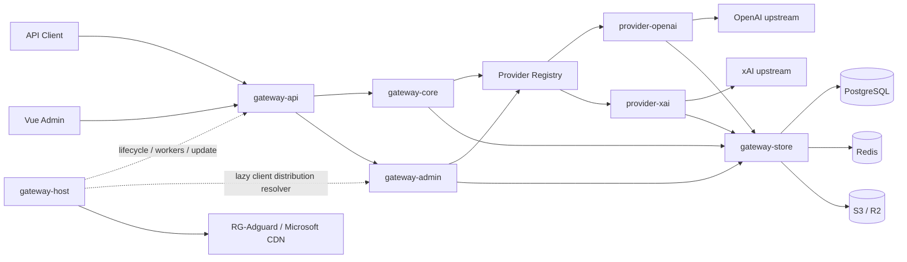
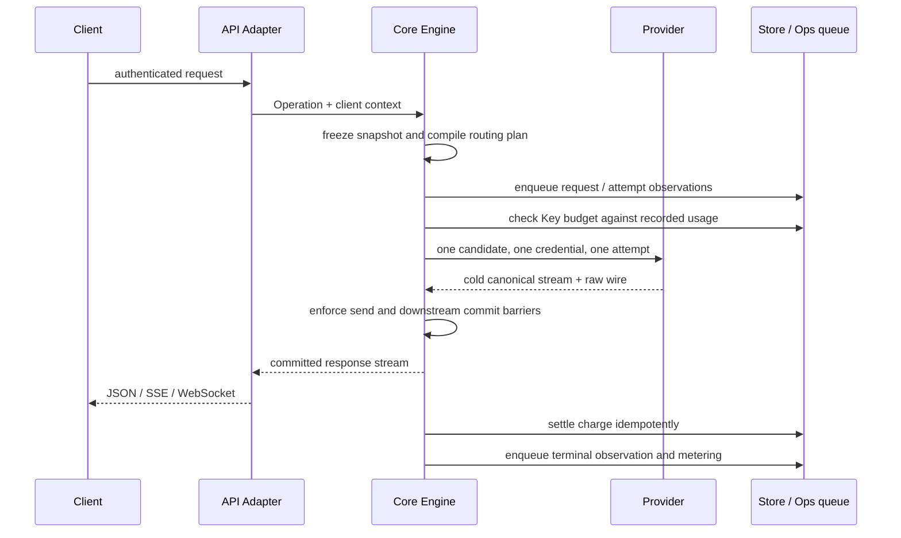

# Codex Proxy RS 架构

本文说明模块职责、请求流程、状态存储和必须保持的约束。
具体 HTTP 字段见 [接口文档](api.md)，部署参数见 [部署文档](../deploy/README.md)；上游 URL、超时、
重试间隔和 UI 布局属于源码或配置，不在架构文档重复维护。

## 1. 系统定位

Codex Proxy RS 是单进程、单副本运行的多 Provider AI 网关，同时提供：

- 面向客户端的 OpenAI Responses、Images、standalone Search 和模型目录协议；
- 带管理员/普通用户角色隔离的控制面和 Vue 界面；
- OpenAI 与 xAI 两个编译期 Provider；
- PostgreSQL 持久化、Redis 协调状态以及 S3/R2 数据库备份。

系统不提供 `/v1/chat/completions`，不存在 Provider Instance 层，也不支持通过复制应用容器进行多副本
扩容。Client Key 限定账号分组，而不是绑定某个 Provider；一次请求的 Provider 候选由账号范围、模型
能力和运行时健康共同决定。

## 2. 运行拓扑



`backend/apps/gateway` 是唯一组合根，按 Host → Store → Provider → Core → Admin → API → Worker 的顺序
初始化具体实现。其余 crate 只暴露自己的配置、端口和 Bundle，不自行定位别的实现。

## 3. Workspace 边界

| 路径 | 责任 |
| --- | --- |
| `backend/apps/gateway` | 读取顶层配置、连接 Bundle、注册 Provider 与 Worker |
| `gateway-protocol` | 跨层共享的 OpenAI wire contract、SSE 编解码与无业务 owner 的解析事实，不依赖其他 workspace crate |
| `gateway-core` | operation、canonical event、请求快照、路由、admission、attempt 协调、交付边界和计量 |
| `gateway-admin` | 管理领域、用例、Provider/Store 端口、审计语义和备份策略 |
| `gateway-api` | HTTP/WS/SSE 解码与交付、Admin wire、静态管理端；不直接访问 Store 或具体 Provider |
| `gateway-store` | PostgreSQL、Redis、S3/R2、`pg_dump` 适配器；不拥有业务策略 |
| `gateway-host` | 配置加载、日志、HTTP 生命周期、Worker 监督和系统更新 |
| `providers/openai` | OpenAI OAuth、账号选择、目录、额度、Responses/Images/Search transport |
| `providers/xai` | xAI OAuth session、账号选择、目录、额度和 Grok/Responses 转换 |
| `gateway-plugin/sdk` | 上游 manifest / RPC / 能力线协议，不拥有本地业务策略 |
| `gateway-plugin/runtime` | 制品校验、RPC 会话、私有状态回调和管理能力适配，依赖 Admin 端口与 Host 进程管理 |
| `backend/apps/plugin-cli` | 制品打包命令，仅依赖 SDK |
| `frontend` | Vue 管理端，仅通过 Admin API 读写状态 |

依赖方向遵守四条规则：

1. Core 不依赖 HTTP 服务或客户端实现、数据库、Redis 或具体 Provider；中间件可使用协议值和惰性正文合同，网络传输仍由 API/Provider 实现。
2. Provider 之间不互相依赖，也不决定跨 Provider fallback。
3. API 只调用 Core/Admin 抽象；Store 只实现端口。
4. 具体实现只在组合根相遇。

组合根的 workspace architecture tests 冻结成员清单、依赖 DAG、公开模块面、源码纪律以及生产/测试模块
镜像关系；具体行为边界由各 crate 的集成测试维护。

### 3.1 Rust 模块组织约定

后端采用目录模块的 `mod.rs` 风格；以下规则由组合根的 workspace architecture tests 扫描全部生产源码与
测试模块树：

1. crate root 作为顶层门面，声明模块并暴露该 crate 的配置、Bundle、端口或稳定领域合同；目录节点使用
   `目录/mod.rs`，叶子模块使用 `名称.rs`，不混用 `名称.rs` 与 `名称/` 两套入口。
2. 生产源码不使用内联 `mod name { ... }`、`#[path]` 或 `include!` 隐藏文件归属。`lib.rs` 和各级
   `mod.rs` 是模块门面，负责声明子模块、选择性 re-export 与少量同层协调。
3. 子模块默认私有；只有真实的跨 crate 生产合同才能使用 `pub`。adapter/provider 的公开根模块由
   allowlist 冻结，变更必须同步完成边界审计，不能为测试或兼容路径创建第二 owner。
4. owner 级依赖保持单向。两个模块互相引用时，应把共享值对象、端口或生命周期能力提升到共同 owner，
   不能依靠同一 crate 内可见性掩盖循环边界。
5. 每个 crate 的 `src/` 与 `tests/` 平级，生产源码不承载测试。`tests/` 镜像 `src/` 的模块目录形态：例如
   `src/foo/mod.rs` 对应 `tests/foo/mod.rs`，`src/foo/bar.rs` 对应 `tests/foo/bar.rs`。一个生产模块可以没有
   测试；额外场景测试必须放在最近的生产 owner 目录下。根级 `support` 和冻结的 crate/workspace 架构场景
   是明确例外。

较大的模块门面只负责组合和 re-export：账号 Admin HTTP 边界按 `wire`、`credentials`、`handlers`、
`presenter` 划分；Provider 执行按 continuation、stream、failure、observation 和 worker 等职责拆分；xAI
请求转换按 response、tools 与 history 拆分。各子模块之间只使用 owner 内最小可见性。

### 3.2 `gateway-core` 内部 owner

`gateway-core` 内共享事实按语义 owner 划分，不再借用 `engine` 作为通用命名空间：

| 模块 | 唯一责任 |
| --- | --- |
| `validation` | 纯值对象校验错误和文本约束，不依赖事件、执行错误或路由 |
| `identity` | Provider 身份值 `ProviderKind`，只依赖纯校验 |
| `account` | Provider 账号/credential/quota 值对象、持久化端口与请求级账号选择；`scope` 持有分组、账号目录和冻结账号范围 |
| `metering` | 标准化 Usage、金额、费用估算与费用明细；不表示账号或开票系统 |
| `upstream` | 跨 Engine、Event、Error 与 Provider 共用的 transport 名称、发送状态和不透明上游值 |
| `lifecycle` | 取消信号、连接注册与 drain 合同 |
| `engine` | attempt、发送/提交屏障、执行编排和持久化调用时序 |
| `routing` | 冻结路由事实、请求计划以及运行时快照的表示与编译 |
| `runtime` | 当前快照的发布、读取、revision 订阅与周期对账任务 |

`event` 通过 `validation` / `upstream` 使用基础值，不再依赖承载原始事件的执行错误；账号值对象和
选择策略通过 `identity` / `account::scope` 使用身份与范围，不依赖路由计划。`routing` 和 `error` 的
既有公开类型路径保留 re-export，定义与 Core 内部使用均归属上述 owner。架构测试约束这些叶子依赖。

`engine::observation` 统一维护单次响应的用量、费用、时间和响应 ID，并负责重试前清理；协调器继续
独占发送、提交、重试和终结顺序。Provider 上报费用优先于本地估算，丢弃的 attempt 不得污染最终计量。
Provider 本地估算按当前 attempt 实际发送的上游模型查价，响应声明的模型只作观测；费用明细复用同一口径。
Client Key 费用账本独立累计各次 attempt 的实际费用，不能因请求重试而清空已产生的费用或未知计费状态。

## 4. 数据面请求生命周期



请求开始时冻结 `RuntimeSnapshot`、Client Key 的账号范围、模型映射、Codex 客户端最低版本、Provider
候选顺序和调度策略。
运行中的请求不再拼接新旧配置，也不在热路径查询分组关系。

Client Key 鉴权完成后，API adapter 从有界请求头识别 Codex Desktop/CLI，Core 使用同一请求冻结的
`RuntimeSnapshot` 比较对应最低版本。Desktop 优先于其 User-Agent 内嵌的 CLI/Core 标记；未知客户端不
应用门禁。低版本或已识别但版本不可用时，在进入 Provider 前返回稳定的 `426` 合同。

核心不变量：

- 一个客户端请求对应一条 `model_requests`；attempt 是请求内事实，不建立第二张权威表。
- Provider 的一次 `execute` 只选择一个 credential 并返回一个冷流；换号、重试和 fallback 由 Core 决定。
- `not_sent`、`sent`、`ambiguous` 是单调的上游发送边界；结果不明确时不能假定上游未收到请求。
- downstream commit 是不可撤回的交付承诺。commit 后禁止换号、重试和 fallback。
- Provider 可将明确容量拒绝标记为有界同账号退避，Core 在既有安全重放边界内执行，按账号维护请求内
  预算，耗尽后复用普通换号路径。该退避消耗总路由预算，与 WS 传输恢复、OAuth 刷新及账号额度冷却分开。
- 有效的服务端 Retry-After（含零延迟、HTTP 日期及流内嵌套头）优先于本地退避；同账号重试和 WS 转 HTTP
  回退仍受请求取消、截止时间和尝试预算约束。OpenAI 的 `flex_unavailable` 明确终止当前请求，保留原始
  拒绝，不自动重试、换号或切换传输，也不因此冷却账号或修改凭据、额度状态。
- 取消等待项随等待 future 的丢弃自动注销；取消广播和注册竞态不丢失唤醒，长连接的 select 循环不累积失效等待项。
- 跨 Provider 只在账号范围和能力都允许，且请求尚未到达上游或已被证明可安全重放时发生。
- 可恢复观测写入失败不能替换已经确定的客户端协议结果。

Responses 按模型目录编译候选；全局模型映射是精确映射，未命中时模型名原样交给候选 Provider。
Images 与 standalone Search 是 OpenAI Provider 自有端点：两者都不参与文本模型映射，只在 Client Key
的账号范围确实包含 OpenAI 账号时生成单一 OpenAI 候选。Images 不要求模型字段；Search body 中的模型
及其他字段保持原始 bytes 并由上游解释。

## 5. Provider 与协议边界

Core 只理解 `Operation`、能力要求、Provider 候选、稳定错误和 canonical event，不读取 Provider SDK
类型。Provider 独占 credential schema、OAuth、账号选择、模型目录、额度投影和上游 transport。

- OpenAI 是透明边界。Responses 请求保留未知字段和字段顺序；SSE、WebSocket、Images 与 standalone
  Search 的业务正文按原始字节转发，原生续写额度恢复遵循下述 continuation 例外。
  canonical facts 从同一数据旁路提取，用于路由、恢复判断、观测和计费。
  Core 的 Provider 流观测同时推进带 wire 和纯 canonical 帧的序列事实，避免混合流漏记开始或完成；
  纯 canonical 帧仍验证顺序，带 wire 帧不会因旁路事实的序列错误被拒绝。
  Responses 在现有 `transport/request.rs` 正文编码边界为缺失的顶层 `store` 补齐 `false`，
  不覆盖显式值或嵌套业务字段；HTTP/SSE 与 WebSocket 共用该边界。
- API 的客户端事件适配将 SSE 上游 `error` 和 WS 客户端无法消费的裸错误转为 `response.failed`，
  复用 Protocol 的错误投影；保留结构化错误与 response 身份，不改写 Provider 的调度或计费事实。
- Responses 的业务扩展头保留原始多值字节；传输与反代请求头分类由 `gateway-protocol` 统一定义，
  API 入站与 OpenAI Provider 编码共同使用。下游链路元数据和压缩协商不跨越该边界，
  上游认证、请求画像与传输字段仍由 Provider 生成；响应方向的诊断头不受请求过滤规则影响。
- xAI 是翻译边界。Provider 把 Grok wire 转换为 Responses wire；上游结构化错误的 message/code/type
  可以透出，但账号指纹会先脱敏。
- response ID 是不透明 UTF-8 bytes，不假设 UUID、固定长度或跨 Provider 可复用。
- 请求画像以配置为启动基线。OpenAI Desktop 与 xAI CLI 的官方版本检查只更新各自负责的运行时画像，
  不回写 `config.yaml`。

### 账号出站代理

出站代理属于账号配置，由各 Provider 在推理、OAuth 服务端交换/刷新、额度、目录和资料等请求中统一使用。
指定代理不可用时请求失败，不退回直连；未配置时直连，不继承进程的全局代理环境变量，TLS 仍验证证书。
用户浏览器访问第三方授权页时的出口不受网关设置控制。

连接池按出口隔离。修改代理推进配置 revision，使后续请求使用新出口；已执行请求可沿原连接完成。
代理变更不推进 `credential_revision`，不会使进行中的令牌刷新因凭据版本冲突而丢失结果。

代理独立保存和测试，通过 `outboundProxyId` 绑定账号；账号保留解析后的 URL 供 Provider 使用。
连接配置改变时在同一事务内同步关联账号并清除旧测试结果，已绑定的代理不可删除。
请求地区由共享代理拥有，账号快照通过绑定投影有效位置，不再保存另一份账号地区配置。
自动模式仅在显式代理测试时识别出口 IP 和地区并缓存；手动模式使用经过校验的位置，透传或识别失败
不改写客户端字段。测试落库推进运行时配置版本，Provider 在选定账号后才对结构化环境及搜索位置应用
该出口的策略，普通推理不额外查询地区。更换出口会使旧自动识别结果失效。
关联账号支持单独移除：在原子更新中校验当前代理 ID，只清除账号的代理 ID 和 URL，
保留账号其他设置；提交配置版本与审计后复用快照发布流程，使后续请求使用直连。
代理目录只携带关联数量；账号明细通过独立分页读端口按需查询，复用代理 ID 索引，
在同一个只读快照中统计并读取有界页面，不在目录中聚合完整账号数组。
文件及 AT/RT 导入在上游凭据交换前取得 PostgreSQL 会话级共享咨询锁，直到凭据提交后释放。
代理修改、删除和测试结果写入通过同一资源的事务级独占锁检查，导入期间直接返回冲突。
锁连接不占用提交所需的连接池槽位，也不持有空闲事务；每进程最多增加四个导入保护连接。
请求取消或进程退出时关闭会话并释放锁。探测器由组合根注入 OpenAI 的 HTTP 客户端构建函数，
复用其自定义 CA 加载与证书校验规则，Host 不依赖具体 Provider 包。
迁移 `0005_managed_outbound_proxies.sql` 将已有 URL 按完整连接信息合并为共享代理，保留认证及账号绑定。

导入器在认证交换前解析并校验账号出口。sub2api 的代理引用按完整 URL 登记为共享代理并绑定账号；
其 SOCKS5 配置按远端 DNS 语义转换为 SOCKS5H。账号导入只迁移账号及出口，不迁移下游 Key、余额或历史用量。
代理认证信息仅通过敏感账号导出返回，列表、详情、Debug 和普通审计不得暴露；数据库及备份按凭据保护。
输入字段、协议支持与导入校验见 [账号 API](api.md#5-账号)。

Managed proxies store names, credentials and connectivity results independently. Accounts bind by ID and retain
the resolved URL for provider transports. Connection edits update all bound accounts atomically and invalidate
old tests; in-use proxies cannot be deleted. Migration 0005 preserves existing credentials and account bindings.
Proxy changes advance the runtime configuration revision without invalidating in-flight token refreshes.

### Codex 原生生图与认证

管理端导出的 Codex 配置使用代理 Bearer 密钥，并声明服务端托管账号认证。
客户端据此开放原生生图工具，图片生成和编辑仍进入现有 Images 路由，不新增独立的登录或图片代理服务。
这只解决客户端能力识别；模型能力、客户端限制和上游账号的实际生图权限仍分别检查。

`X-OpenAI-Actor-Authorization` 是客户端能力标记，不是账号凭据。API 解码和 OpenAI Provider
都过滤该 header，网关继续校验 Client Key，上游认证由服务端账号产生。
仅含代理密钥的本地 `auth.json` 可以与新配置共存。配置示例维护在
[部署文档](../deploy/README.md#客户端配置)。

客户端到代理与代理到上游的传输选择相互独立。客户端的 `supports_websockets = false`
不禁止 Provider 使用上游 WebSocket。响应终态前的 Close 1000 仍视为失败，
后续恢复请求成功也不改写原失败请求的结果。

### 错误与诊断三层边界

错误信息按用途分成三层，不能用同一个 `message` 同时承担协议、界面和诊断职责：

1. **数据面协议错误**：`/v1/*` 继续遵守 OpenAI/xAI wire 合同。可交付原始上游响应时保留其状态、headers、
   content type 和 body；原生续写额度恢复由 Provider 单独投影客户端响应，真实上游事实仍用于诊断和记账。
   本地 fallback 使用数据面稳定机器码与安全英文，不受管理端中文化影响。
2. **控制面展示错误**：`/api/admin/*` 由 API 统一 HTTP 状态与数值业务码，由 Admin/API owner 提供安全中文
   文案。extractor rejection、namespace 404 和 method 405 也使用同一 JSON 信封；任意 Store、Serde、
   Provider `Display` 不得直接跨越 HTTP 边界。
3. **原始上游诊断**：只在连接测试、运维错误详情等明确诊断界面展示已经捕获的原始字段，不翻译、不补造，
   也不塞入普通 Admin 错误信封。原始 body 不进入 Debug、普通日志或持久化错误消息。

连接测试的 `gateway` / `provider` / `upstream` 来源以及 `not_sent` / `sent` / `ambiguous` 发送状态由 Core 在
仍持有完整执行错误时一次判定；Vue 只能根据稳定字段生成摘要，不能匹配英文错误句子反推来源。

## 6. 路由、账号范围与 continuation

Client Key 与账号分组形成授权范围：

- 没有分组关联表示 `AllAccounts`；
- 有关联时只允许已启用分组成员的并集；
- 已绑定分组为空或全部禁用时得到空池，绝不回退为全部账号；
- 分组可以包含多个 Provider，账号也可以属于多个分组。

账号选择综合启停状态、credential/quota 事实、Redis cooldown、并发上限、权重、请求间隔和会话亲和。
`account::AccountModelAccess` 拥有管理员模型政策的校验与精确匹配语义，存入账号行的 `model_access_json`，
由 `RuntimeAccountDirectory` / `FrozenAccountScope` 随配置快照冻结。Provider 在额度、亲和与租约之前
按映射后的上游模型筛选账号；重试和 fallback 使用同一冻结政策。上游目录和凭据不承载或改写该政策。
客户端目录还按 Provider 记录的模型来源账号过滤：来源必须在当前冻结范围内且允许该模型；
模型别名按映射后的上游 ID 判断。来源用于目录可见性，不作为额外的推理能力白名单。
暂时并发或间隔容量不足与无资格账号分别分类；目前没有账号等待队列。

账号编辑在一个事务中更新调度事实，批量更新只应用显式提供的字段。导入与首次 OAuth 可携带统一账号设置，由 Admin 传递给 Store，
与凭据在同一事务中提交；Provider 仍独占凭据解析。未附带设置的导入、重新授权和后台刷新保留已有分组、
权重、并发与模型政策。模型政策变更推进配置 revision，不推进 credential revision。管理端导入和账号编辑共用设置表单，凭据输入独立于设置。

Continuation 仍受原请求的 Client Key、账号范围、Provider 和发送/交付边界约束：

- native continuation 固定创建它的 Provider 与账号；
- OpenAI 在交付前收到可安全重放的明确额度拒绝时，先隔离账号，再投影 `ClientReplayRequired`；
  丢弃未交付的原错误帧，由客户端提交完整历史开启新链，不把原增量输入交给其他账号。
  真实错误分类、状态码、发送状态和上游诊断保持不变，客户端合同见 [Responses API](api.md#3-openai-数据面与模型目录)；
- OpenAI 按 native → replay owner → replay any 推进，并保留官方 `previous_response_id` 语义；
- xAI 使用客户端提交的完整历史作为重放输入；
- scope 外账号、跨 Key 复用或不明确发送结果均 fail closed。

会话亲和是优先选择提示，不是硬账号绑定；native continuation 才携带不可跨越的 owner 约束。

### Client Key 限额与结算

日金额和七天金额由账号分组配置，同一用户在同一分组下的所有 Key 共用金额窗口；并发和 RPM 继续按 Key 跨账号、跨 Provider 合计，零表示不限。修改限额不重置已用金额。
Core 负责准入与结算时序，Store 持久化原用户与分组账本，Admin 负责限额配置。Store 在准入时按请求的公开模型冻结分组倍率及适用费用项，Core 保留这份事实并累计各次实际尝试的原始费用与已知费用明细。结算和异步请求记录均携带相同规则，账本复用原数据库的精确费用计算，不读取尽力写入的请求记录，也不在结束时查询当前倍率。总费用倍率作用于原始总额；采用分项倍率时，仅对已取得明细的费用项应用倍率，无法拆分的部分保留原价。

- 日窗口按北京时间零点划分；七天窗口从首次准入当天零点开始，到期后由下一次使用重新开启，不固定为周一。
- 金额优先使用 Provider 上报的 USD，否则按现有模型价格估算；订阅账号的估算费用不代表上游订阅账单。
  费用归属请求完成时间，跨日请求计入完成日，延迟写入仍保留原完成时间。
- 准入检查已结算金额，不预占未来费用。达到任一金额阈值后拒绝新请求，已准入请求仍可完成并使总额超过阈值。
- SSE 持有并发名额直到终态；WebSocket 每个 `response.create` 独立准入，空闲连接不占名额。
  Core 在每次请求开始时重新鉴权并冻结当前策略，既有连接也应用已发布的限额与授权范围变更。
  换号和内部重试复用同一名额，Key 与账号并发上限同时生效；预算拒绝或启动失败释放名额。

完成、失败、取消和断连使用同一结算路径，在结束时以网关请求 ID 幂等累计已取得费用。
缺少用量或价格、无法取得 USD 费用的尝试按零累计，不创建待核账记录，也不会阻断 Key；
内部重试中已经取得的费用仍须累计。发送状态只决定重放是否安全，不能据此推断费用。
请求日志继续保留真实错误、用量与费用来源，账本按零累计不表示上游实际免费。

结算写入失败时，进程内保留精确费用和原冻结规则，在同一用户与分组的新请求前重试，当前倍率变化不使待写费用被跳过或重新定价；进程退出后无法恢复的费用不会形成欠账。
PostgreSQL 不可用时拒绝所有新的计费请求，Redis 继续管理并发/RPM 租约。
账本独立于可丢弃的请求观测日志，日志清理不重置金额；费用事件保留至删除 Key，已有日志不会回填为账本费用。
字段与错误合同见 [Client Key API](api.md#7-client-key)。

## 7. 控制面与 revision

账号额度预测由 Admin 配对 Provider 解释的额度观测与 Store 的完成用量累计。只读查询使用单一 MVCC
快照，最多查询 32 天并选取 128 个历史文档；先聚合再读文档，不查询模型排行、不额外刷新上游。
分段选择只使用同一套餐和重置周期，优先最近三个至少 5 个百分点的完整块及尾部；费用完整性与 Token
完整性分别判断。原始费用和历史倍率后费用使用相同采样边界，不通过当前分组倍率倒推。
原 `0017` 估算表保留迁移兼容，但不再读写或复用旧结果，历史请求观测是唯一采样来源。

管理写入遵循统一流程：

```text
HTTP validation
  -> Admin use case
  -> Provider prepare/verify when needed
  -> PostgreSQL transaction + audit
  -> publish committed runtime snapshot
  -> notify Provider-derived caches
```

会改变路由快照或安全配置的 mutation 在同一 PostgreSQL 事务中提交业务事实、推进内部
`config_revision` 并写入脱敏审计。Admin mutation 不要求客户端提交 revision；少数账号/分组响应
返回已提交的 `configRevision`，不将它当作乐观并发前置条件。

额度、cooldown、目录 generation、请求统计和自动 credential refresh 属于运行时观测，不推进全局
revision；credential 轮换只推进账号自己的 `credential_revision`。Redis 通知用于缩短收敛延迟，
PostgreSQL 周期对账才是正确性基础。已提交配置发布可打断慢后台目录读取，复用上次目录数据，
同时从最新配置重新编译用户、分组与模型权限。后续后台对账更新目录；旧后台任务不能覆盖新权限。
配置读取失败仍暂停新请求，已开始的请求保留自己的冻结快照。

## 8. 状态所有权

| 状态 | 唯一权威 | 说明 |
| --- | --- | --- |
| 账号、credential、分组、Client Key、设置、审计、请求与备份记录 | PostgreSQL | 业务持久化事实 |
| Client Key 金额窗口与费用事件 | PostgreSQL | 准入与幂等结算的权威账本，独立于请求观测与日志保留策略 |
| admission、lease、cooldown、会话亲和、continuation、OAuth pending、目录 cache | Redis | 可重建、可过期的协调状态 |
| 日志、OAuth 恢复记录、在线更新状态、备份暂存 | `.runtime/` | 部署节点本地运行文件 |
| 重置卡库存与消费结果 | OpenAI upstream | 后端不建立本地卡库存；前端只保留当前浏览器会话的最近查询 |
| Provider 公开模型与请求画像 | Provider/runtime cache | 由官方目录或发布源刷新，不写成第二份业务配置 |
| Windows 安装包临时直链 | Host 进程内短缓存 | 按需解析、严格校验、到期前丢弃；不写 PostgreSQL/Redis，也不代理包字节 |

账号对外状态不是独立列，而是 PostgreSQL credential/quota 事实与 Redis cooldown 的统一投影：
`normal`、`quota_exhausted`、`rate_limited`、`disabled`、`error`。只有明确上游证据才能恢复或终态化账号，
本地时钟和不确定响应不能伪造事实。

PostgreSQL schema 由迁移目录按编号管理。已应用迁移按字节冻结，后续 schema 变化只能新增编号迁移，
详见 [迁移规则](../backend/migrations/README.md)。

## 9. Credential、额度与主动重置

credential 与 quota 是两组独立事实：credential refresh 不等于 quota refresh，额度接口的 401/403
也不能单独证明 refresh token 永久失效。

- OpenAI 支持 OAuth、AT/RT 与 OAuth JSON，导入识别 camelCase 和官方 `auth.json` 的 snake_case token 字段；
  RT-only 导入先换取 AT，AT-only 导入没有
  自动续期能力。OAuth 身份只从官方 JWT claims 投影，不信任导入文档顶层身份字段。
- xAI 使用 OAuth session；API Key 不是受支持的账号 credential。刷新额度时同步查询官方实时订阅，
  只把套餐事实写入现有 quota JSON。明确无付费订阅的个人账号显示 Free；查询失败、缺失字段或
  团队身份不推断为 Free，订阅查询失败不影响额度观测。
  Codex custom 工具统一以 function 的 `input` 字符串包装，保留说明与 grammar；响应恢复
  原工具类型及对应 item ID，`call_id` 始终保持配对。转换仅处理协议字段，超限或转换失败终止流。
  默认 `store: false` 的续接使用现有会话 owner 重放完整历史；上一轮要求上游存储且指令未变时，
  原生续接移除本轮 `instructions`，避免 Grok 拒绝与 `previous_response_id` 同传。
- 新账号导入和首次 OAuth 在 credential 提交后尽力读取一次额度；失败只留下观测，不回滚账号事务。
- quota refresh、正常推理返回的 rate-limit headers 和后台健康任务汇入同一额度事实；套餐只用于展示与
  目录 cache 隔离，不创建套餐专属状态机。
  OpenAI 明确报告的套餐与额度原子提交，共用凭据版本和观察时间保护；空值和 `unknown`
  不覆盖已有套餐，同族泛化值保留具体子类型。Token 刷新保留提交时的账号资料，
  避免覆盖刷新期间由额度观测更新的套餐。

主动额度重置是 OpenAI Provider 的不可逆上游操作：列表查询和消费都直接使用当前 Desktop 请求画像；
卡片不写 PostgreSQL/Redis。消费请求携带调用方生成的 UUIDv4 幂等键，同一账号的消费在进程内串行；
发送结果不明确时必须复用原键。确认成功后管理端再显式刷新卡片与 quota，不能直接改本地重置时间。

## 10. 观测与后台任务

请求观测通过有界进程内队列异步投影到 PostgreSQL。队列满、Store 暂不可用或进程退出超时时，允许丢失
可恢复观测并累计指标，但不允许改变客户端响应。Usage 详情中的 attempt 因此是 best-effort，并通过
`attemptsComplete: false` 明示不完整性。

只有完整交付客户端的成功响应进入 Token、延迟和成本聚合。实际 `service_tier` 只接受上游响应事件确认，
不能用请求期望值替代。

Worker 由各 Bundle 贡献、由 Host 统一监督：

- Store：过期请求恢复、历史保留和 PostgreSQL/Redis 观测队列；
- Core：`runtime` owner 的 RuntimeSnapshot 周期对账和 Redis change 订阅；
- Admin：S3/R2 备份、订阅/额度采样、价格同步和已发布插件实例维护 daemon；
- Provider：credential refresh、quota/catalog 健康和官方版本/etag 检查。

周期任务的 Redis lease 只保证单周期互斥，不构成多副本 leader 选举。备份 daemon 依赖单副本部署边界，
自更新也只替换处理请求的当前进程，因此整个应用必须保持单副本。

价格同步由 Admin 决定策略，Host 负责固定远程来源的下载、摘要验证和 LiteLLM 格式转换，
Store 在事务内保存价目、策略与审计，并通过原有配置修订发布 Core 快照。
后台每 10 分钟检查，默认只加入未知模型；推理请求只读已冻结快照，不访问远程价格服务。
人工覆盖优先于同步层，内置价目用于兜底；上游明确上报的实际费用仍优先。
已结算费用和请求时分组倍率不会随当前价目重算。详见 `docs/model-pricing.md`。

## 11. 生命周期、安全与恢复

启动只有在配置、PostgreSQL、Redis、Provider、Core、Admin、API 和 Worker 全部初始化成功后才进入服务。
健康检查综合 Core、Store 与 Worker 状态，但不会把单个 Provider 的业务降级等同于整个进程失活。
组合根在启动时只把 Host 的 `ClientDistributionResolver` 能力注入 Admin；此时不访问 RG-Adguard，下载
HTTP Client 构造失败也不会阻断网关启动。外部解析在已认证管理员首次打开客户端下载弹窗时惰性执行，
失败时按架构使用 OpenAI 官方稳定地址。Microsoft Store 内容通道返回的 HTTP/80 临时链接保留原始 scheme，
不会被错误改写到该 host 不保证支持的 HTTPS 虚拟主机。

关闭分为两段：先停止接收新连接并 drain HTTP/WS，再取消并等待 Worker；两段各有独立预算，Compose 的
`stop_grace_period` 必须覆盖二者之和。WorkerSupervisor 持有自己的关闭信号，HTTP/WS 或命令的请求取消不会
抢先停止 Store 写入任务；Host 在原连接或调用图排空后发出该信号并 join。超时后只丢弃仍未落盘的可恢复观测，不执行隐式业务重放。

安全边界：

- Provider credential 以 Provider schema 的明文 JSON 保存在 PostgreSQL；数据库和备份必须按敏感数据保护。
- `host.logging.oauth_recovery` 默认关闭，开启后将 OAuth 原始 AT/RT 写入独立文件；
  与普通文件日志开关分别控制，不输出到普通日志或 stdout。`.runtime/logs` 同样属于敏感数据。
- `host.logging.request_dump` 默认关闭；开启后独立请求转储包含原始请求头和正文，
  可能包含密钥及用户内容，只能在明确的排障范围内使用，不能作为普通日志公开。
  普通及 OAuth 文件按 `file.retention_days`（默认 7）保留；报文按独立的
  `request_dump_retention_days`（默认 1）保留。保留当天及前 N 个完整 UTC 日期的所有分片，
  仅整组清理更早日期；近期被写入的旧日期组延后清理。不存在文件数量淘汰。
  `file.max_file_size_mb` 只控制轮转；已关闭分片压缩后才删除原文件，启动和轮转时清理过期日期。
  文件队列满时背压，正常关闭时排空并同步。`file_logging` 健康探针持续报告本次进程的写入缺口，
  不将压缩/清理失败伪装成保留完成。容量规划须覆盖完整时间窗口，不能靠提前删窗口内分片解决磁盘不足。
- Provider 将安全诊断的阶段、原因码与消息独立于错误大类和发送状态传入 Core；
  `attempt.failed` 保存这些字段，最终错误记录优先持久化诊断消息。重试包装不能覆盖底层诊断，
  也不能因为错误更详细而改变已有重试安全边界。
- 真实 secret 不进入普通日志、Debug、fixture 或 audit details；明文只能通过账号导出、Key reveal、
  备份设置等明确的敏感 Admin 合同返回。
- OAuth pending flow 使用有期限、带 owner 的一次性 claim；事务成功后才消费，失败释放 claim。
- 在线更新校验 Release host、大小、SHA-256 和归档路径，并只允许同一大版本内更新。

PostgreSQL 备份恢复属于人工维护操作。当前没有部署级维护模式开关，需要先停止应用，
离线处理快照中的非终态任务、计划游标和到期清理条件，再重新验证对象存储并恢复计划。
关闭计划开关只阻止新计划任务，不会停止 Worker 的任务恢复和删除流程。
未经核对就启动旧快照，可能触发远端对象删除；操作步骤见 [部署文档](../deploy/README.md#人工恢复数据库)。

## 12. 修改与验收

变更应落在拥有该事实的边界：协议适配进 API，执行策略进 Core，Provider 差异进对应 Provider，持久化
实现进 Store，生命周期进 Host，管理规则进 Admin。不要用兼容 shim、第二套状态机或跨层旁路绕开 owner。

后端验证从 `backend/Cargo.toml` 执行，仓库根目录没有 Cargo manifest：

```bash
cargo +1.97.0 fmt --all --manifest-path backend/Cargo.toml -- --check
RUST_MIN_STACK=16777216 cargo +1.97.0 clippy --manifest-path backend/Cargo.toml --all-targets --all-features --locked -- -D warnings
RUST_MIN_STACK=16777216 cargo +1.97.0 test --manifest-path backend/Cargo.toml --test main --locked
pnpm --dir frontend format:check
pnpm --dir frontend build
docker compose -f deploy/compose.yaml config --quiet
```

线程栈设置与当前 CI 一致。PostgreSQL/Redis 集成测试需按
[迁移文档](../backend/migrations/README.md#本地测试库) 配置专用测试库；未设置环境变量时，本地相关测试会跳过。
前端以 lint、类型检查和构建验证，`build` 已包含类型检查，不维护独立前端测试代码。

行为、配置或边界变化必须同步其唯一文档 owner：用户入口写入根 README，HTTP 合同写入 `docs/api.md`，
部署操作写入 `deploy/README.md`，架构不变量保留在本文。

## 用户隔离与分组额度

用户统一存于 users；原管理员迁移为 admin，后台新建身份固定为 user。Redis 会话保存用户 ID 与 auth_version，每次鉴权回读 enabled/version。AdminAuth 负责全局管理，UserAuth 只接受个人会话；部署级 API Key 不可代用户访问密钥。

client_api_keys.owner_user_id 不可由 API 修改。创建/变更在事务内重新校验所有权和 user_account_groups 授权，唯一索引限制一个 Key 一个组。快照排除禁用用户、未授权或未绑定启用组的 Key。请求准入再次检查实时用户/组权限，返回冻结的 ClientBudgetScope；model_requests.user_id 独立于可删除的密钥外键保存。

account_groups 配置日/周 USD 限额；user_group_budget_windows 按 (user_id, account_group_id) 维护窗口，user_group_charge_events 按 request_id 幂等结算。删除/改绑 Key 不改变计费归属和已用金额。使用记录查询在 SQL 层按可信用户 ID 限定，个人响应采用字段允许清单，避免新增诊断字段自动暴露。

密钥仍以明文持久化，以支持本人再次读取；“管理员不能查看”由应用权限保证，不隔离数据库、备份或部署主机的操作者。后台备份仍属于部署管理权限。


### 连接恢复与响应控制

Core 为一次请求共享发送前建连预算，只有可靠 NotSent 失败才能申请同账号连接重试。
已发送或结果不明时不能使用此路径重放。Provider 全局熔断已移除；OpenAI WS origin 级连接保护仍由 transport 拥有。
HTTP/WS 共用有界建连准入，排队取消释放名额，本地建连容量拒绝不投影为账号或上游故障。

OpenAI 在允许 HTTP 的请求上发送前估算 WS create 大小，过大时切换传输；增量续接需要完整历史时返回客户端重放提示。
预提交缓冲受时间与字节双重边界约束，记录提交原因，不能无期限积压非终态输出。

每次执行持有自己的 ResponseControl。Provider 在确认 response ID 后注册目标，并在终态/退出时释放；
API 的 response.interrupt 只引用该目标，Provider 向原有活动 WS 发送中断。后续 response.create 仍有界串行排队。
控制帧处理期间保留同一个执行读取 future，不取消正在进行的结算与正文处理。

## 插件生命周期

Host 在 HTTP 或命令排空之后、后台任务和日志关闭之前，等待组合根提供的扩展收尾。插件撤销发布、停止进程并等待已接受的原生任务及日志，仍使用各自原有的完成与期限合同。进入插件初始化阶段后的启动失败也走同一关闭流程；监听失败、信号或命令结果不会跳过扩展收尾，不另建调用图或提前关闭 Store 写入任务。

插件私有数据的当前 schema 与记录由原 PostgreSQL Store 持有；停用时更换目标制品不改变这项数据事实。Runtime 解释清单、验证 schema 并调用候选进程的状态迁移方法，Admin 协调准备和发布。转换结果与实例 revision 在同一原生事务中提交，提交前再次比对源快照；准备失败或源数据变化时保留旧版本。普通配置更新没有数据合同变化时沿原实例保存流程，不冻结状态写入。卸载由原实例外键清理记录及 schema 元数据，不建立另一套实例配置或业务账本。

插件亲和查询经 Runtime 的原生模型调用范围和 API 执行 facade 进入 Core。Core 验证存活的父请求、冻结 Provider/账号范围、原期限和授权撤销，读取 Store 已提供给 Provider 的同一个 Redis 亲和端口；结果不匹配范围时只返回未命中。查询不创建新的亲和状态、执行图、账号租约或账本，仍受现有协调等待上限约束。

插件 `host.log` 复用 Core 的诊断脱敏和宿主 tracing，不建立独立日志存储。Runtime 从真实 RPC 调用绑定日志身份，按 incarnation 维护每秒 64 条预算，所有实例共享 8 个写入槽位；输入限 8 KiB、32 个字段，事件名只输出指纹。耗尽时同步返回未接受，阻塞后端不占用协议读取任务。每个进程的日志生命周期保管同一个排空 future；等待者取消、重复停止不能转移已接受写入的所有权或提前完成。Runtime 以弱引用追踪候选和活跃日志生命周期，阻塞写入在完成前保留其 owner，因此准备失败或被取消的候选仍能在退出时排空。Admin 保管同一个实例退出 future，先撤销发布并停止活跃进程，再关闭 Runtime 日志注册和接收、等待候选写入；退出等待被取消后可继续原过程。

静态管理资源的公开性来自当前 LivePlugin 的已验证注册声明，并随原实例 revision 发布。Admin 的公开读取先取得同一活跃进程，再核对精确路径和 `public` 标记；Runtime 只从已校验归档读取资源。API 将匿名静态资源与管理员调用分为两个入口，均用 JSON envelope/base64 传递资源字节；公开资源不创建管理会话或模型调用身份。版本切换和停用沿原发布撤销失效入口。

组合根在 Store 初始化后装配 PluginManager 和 PluginEngine，在 API 启动前恢复启用实例，并在关机时回收插件进程。Admin 是实例配置与版本切换的业务 owner；Store 保存制品、敏感配置和私有状态；Host 负责进程容量与终止回收；Runtime 负责协议和能力适配。数据库 CAS 提交先于新实例发布，旧 revision 的入口和私有状态写入随切换失效。

命令注册和 SDK 参数解析由 Runtime 持有，描述符保存在实际 LivePlugin，不另建命令代次索引。Admin 在原 active 发布和持久化实例 revision 中校验执行资格，候选注册失败不替换旧命令。命令是宿主根调用，不构造模型父执行或管理员会话；本人调用保留原 Key 归属检查，只有宿主绑定的 System、command_line 阶段、无父执行且持有真实根调用图的作用域可查询全局非秘密 Key 投影并按 ID 选择 Key。Store 直接投影原 client_api_keys 的 ID、名称、启用状态，模型授权复用 Core 原 authenticate_bound_key 入口及授权 epoch，不读取明文密钥或增加 Key 索引；管理阶段的 System、管理 API Key、插件 actor 和父执行不会继承全局列表权限。私有状态、服务、模型与 HTTP 沿该次 RPC 的真实实例、调用图和取消链执行。冻结服务显式缺失时不查询新发布；回调、模型流和网络正文随作用域清理。参数和 stdout/stderr 不实现内容型 Debug，错误不回显参数或凭据；已执行后无法确认的结果保持副作用未知，不自动重放。命令行在 apps/gateway 的原组合根选择终端行为，Admin 决定版本、帮助和执行，Host 负责原信号、排空时限和 worker 关闭，不绑定 HTTP listener。Host 与 Runtime 持有同一 Core 根调用图；Core 在原 permit 释放后通知等待者，保留调用次数限制及原结算 owner，不另建清理队列或会话计数。Host 的调用结果与调用图排空事实分开，超时不丢弃已确认结果，Console 以失败退出并说明未确认副作用。命令账号结果沿 Runtime 的 SDK facts 转换、Provider 原生身份与凭据校验、Admin 原导入/轮换提交及 Core 发布执行；Store 在同一事务内锁定实际启用的插件 revision，替换另检查原凭据 revision。RPC 和逐项保存共用总期限，只报告已确认提交数；开始准备的原生账号任务保留原调用图 permit，取消等待后继续完成其事务与发布，不自动重放或重绑身份。该入口仅限实际系统命令，非零退出不保存账号，沿原插件审计及账号设置 owner，不增加账本或命令状态机。command_line v1 可通过正常安装校验并启用；真实 CLI 恢复、帮助、原生账号提交、非零退出和停用恢复沿同一组合根验收。其他能力的生产门禁仍按各自合同独立判断。

账号凭据回调复用同一 InvocationCalls 中的实际操作者、完整 SDK 上下文、Core 调用图、取消与总期限。Runtime 的全局账号回调只接受管理员管理调用、真实 System 根命令和宿主创建的维护任务；Admin 从原 AuthStore 核验管理会话的角色和启用状态，Store 的读取与提交事务锁定实际启用的插件 revision。list/get_runtime 直接投影原生账号元数据，显式 get 使用原 ProviderDocument 敏感导出合同，不新增凭据缓存或状态索引。save 与命令结果共用 Provider 的原凭据准备、身份检查和导入/轮换事务；原 SQL 的 RETURNING 同时返回账号 ID 与本次提交的凭据 revision，Admin 原导入及授权提交传递该回执，不在提交后另读版本充当提交事实，普通 HTTP 导入响应保持原合同。开始 Provider 准备时标记原 Core 祖先调用图的副作用，原生任务持有同一图的 permit，取消等待后仍完成事务与发布；不重放写入，不把插件声明变成凭据或费用权威。上游适配器读取使用原 ManagedCall 的实际 Provider 账号租约、完整 SDK 上下文及取消链，原 Admin/Store 端口只查询该账号。list 的 Provider/游标过滤最多投影一个账号；其他账号不可读取。当前存储版本和认证类型必须等于租约持有事实，变更时拒绝导出，启用实例与插件 revision 继续由原存储事务检查。读取不新增凭据缓存、选号或容量租约；Core 的 UpstreamCredentialUpdate 能力只能从实际选中 Provider 连接取得；它只接纳精确的原生提交版本，不接受未验证材料或持久化写入。Provider 用原 codec 和账号仓库加载该版本，核对账号、认证类型、主体及出口代理；新凭据快照共享原容量 guard，Core 定价与失败反馈仍归原 owner。接纳开始后暂停认证头构造，载入失败或 future 丢弃时保持旧材料不可用，保留最后确认版本；过时的 expected revision 在开始前拒绝，不撤销已确认的新版本。Runtime 的绑定 save 只允许当前账号的准确版本替换，不支持新建或其他账号，权限仍来自原选中租约及宿主上下文。原 ManagedCall 的读写锁覆盖凭据读取、认证头构造、实际网络操作和保存/接纳；旧正文与 WebSocket 被关闭，HTTP 复用作用域及续接持有版本切换到准确回执。SDK birth 上下文不改写，当前凭据 epoch 来自原 Provider owner。具有相同原 Core 子 permit 的任务保留提交、发布和接纳责任，原 InvocationCalls 的完成视图参与退出等待；失败终止本次调用，旧 expected revision 在开始前拒绝而不撤销新 epoch。借用祖先账号且不允许修改状态的租约不提供更新能力。OpenAI 的真实保存、HTTP 互斥、WS 握手/续接和取消排空已验证；xAI 的原账号代理、官方 OAuth discovery/UserInfo、准备刷新、原生保存和准确版本接纳已由隔离 TLS 环境验证。保存后认证头来自已校验材料，主体或 issuer 不匹配时原调用取消且不写库、发推理或重放。目标第三方制品、其余回调和完整退出仍待验收；upstream_adapter v1/v2 已允许正常上传、启用和恢复，不放宽全局回调替代绑定合同。

主动额度刷新使用相同宿主签发的账号操作者策略与原 InvocationCalls 调用图。只读事实仍直接读取已有观测；显式 refresh 在原用户存储与插件 revision 事务核验权限，再沿原 AccountsService 的 Provider 查询、订阅观测和本地归属流程更新事实。它不拥有账号凭据、充值或预算重置，不维护第二套额度状态。元数据等待后重新核验管理员，返回前再核验操作者与插件 revision；撤权抑制返回但不撤销已开始的原生观测责任。原 Core 子 permit 和副作用标记覆盖任务，等待者取消或超时不丢弃 Provider/Store 收尾，插件 stop 等待同一完成投影，未确认结果不自动重放。

账号提交的关闭事实来自 Core 原 ActiveChild：只读完成句柄持有原图的通知与 permit 弱引用，不持有 permit、放大调用权限或复制完成状态。Runtime 原 InvocationCalls 在 RPC 结束时立即撤销操作者，若原生账号任务仍在运行，只保留其实际 permit 的完成投影；完成后移除登记，未完成调用计入同一有界容量。host.auth.save 和命令结果登记同一原生提交，后续取消不会丢失其收尾责任。LivePlugin 撤销入站与调用取消后，沿原 RPC shutdown 确认回调析构，再等待这些实际提交的 Provider/Store/Core 收尾；不等待同图父调用或兄弟任务，也不把管理/维护身份延长为新的回调权力。PluginManager 原 shutdown 继续负责实际进程集合，没有新增凭据、命令或收尾任务状态机。

受管上游适配端口只替换 Generate 的业务 wire。Core 将请求冻结计划传入原协调器；Provider 在原生解码前选择适配器，但仍独占账号租约、凭据解释、定价和失败反馈。适配器调用受首次流消费屏障约束，沿原取消、重试和结算链执行。Runtime 在候选进程准备时校验上游适配声明；Host 的受管出站模块统一负责 HTTP/WebSocket、DNS 固定、代理、TLS、容量和资源回收。Core 会话状态保留扩展执行归属与连接范围；无适配器时原生 Provider 拒绝消费扩展私有状态，中间件对归属事实的投影不改变宿主权威。Runtime 的网络回调绑定原请求、attempt、账号和凭据版本，事件经过序列验证，成功终态等待 RPC 正常结束；尾部失败仍保留计量事实。续接由同代连接池独占保管，核对实例、Key、账号与凭据版本，空闲连接不持有账号租约，撤销时关闭。Admin 在原发布快照中冻结实例绑定，按 Provider、公开模型与原 Key/分组范围选择，拒绝重叠发布并排除发起祖先；失效实例保留拒绝门禁，成功选择后撤销加入原取消链。绑定沿原实例 CAS 和恢复流程持久化。其余阶段授权及完整端到端验收尚未完成，生产能力保持关闭。

upstream 的嵌套模型、内部 HTTP 和私有状态回调沿同一宿主在途 scope 授权。Runtime 将原 Core 父调用绑定到既有 Models 回调 owner，不通过插件的 wire ID 创建权限；父子调用保留冻结策略、调用图、取消及原结算入口。子模型不复用父调用占用的账号，发起插件祖先从子调用的适配计划中排除。内部 HTTP 使用原父请求冻结的 dispatcher，产生效果后原 Core 禁止父请求透明重放；未读子流不触发 Provider。RPC 终态或撤销关闭关联资源。本阶段的主动 service 使用宿主签发的插件实例/revision 身份及原冻结服务发布，不构造管理员会话；其余回调继续接入。

Admin 的插件服务身份由 Runtime 验证后的实例记录及原 PluginAccess 代次租约签发，不从 RPC JSON 构造。公开服务 dispatcher 将其绑定为独立 Plugin 审计操作者，实例不符或撤销后拒绝调用；原 SettingsService、事务、配置发布与取消后的写入收尾继续负责实际业务。审计使用既有 admin_audit_events，追加 0039 扩展 actor kind，历史事件不回填。公共 settings 使用上游三类 MutationContext DTO；插件主动调用在传输中投影为 System，原终端仍持有并使用实际 Plugin 审计上下文。操作者及请求关联的传输改写在终端前拒绝。local.settings.v1 单独暴露 Plugin 扩展，不改变同名上游合同。插件身份不转换为用户会话或共享额度管理权限；Provider pending owner 保留实例和 revision，不能跨代完成授权。Core 的 PreparedRoot 与 NestedExecutionContext 携带原请求的冻结服务工厂，RetryInput 仅传递原工厂和调用图事实。Runtime 的 request/attempt、routing/scheduling/retry/upstream 将其绑定到当前实际进程租约；RPC 完成或取消撤销该调用端口，原事务仍按既有 owner 收尾。服务中间件的进程身份由宿主重新绑定，已鉴权管理调用保留原操作者。HTTP、独立 WebSocket、注册及认证的主动 service 已接入：HTTP dispatcher 和 WebSocket 计划持有入口冻结工厂，原 HTTP 认证优先继承该入口；注册和无父入口认证从原组合 owner 在 RPC 前冻结发布。空端口及冻结失败不回退更强身份。WebSocket 独立消息创建新预算，从模型或内部 HTTP 子调用建立的连接保留原图及累计预算；运行时同时继承其原取消和期限。其余阶段继续实施。

Runtime 的通用外部 HTTP 与上游专用 HTTP 使用同一个受管网络资源 owner，复用 Host 出站端口、原调用期限和取消链。前者保留插件显式请求头；只有上游专用入口装饰选定账号凭据。upstream 的通用请求继承账号代理并共用发送水位，辅助发送及不确定发送沿原调用图禁止透明重放。模型服务未配置时仍可使用通用 HTTP；管理、middleware 和策略入口由各自原 owner 绑定真实调用图与撤销源，重试输入只增加宿主调用图事实，不增加模型或管理权限。RPC 终态与提前退出关闭同一套正文资源，句柄不能跨 scope 使用。

插件私有状态与用户共享账本相互独立。当前开放管理员管理能力、私有状态、只读事实、显式共享额度管理和经 Core 执行的页面推理。支持矩阵、可信进程边界和恢复操作见 [插件文档](plugins.md)。

插件页面推理经 API 的静态 `/api/admin/plugins/models/responses` 入口，以本人会话解析本人 Key，再进入现有 Responses delivery 与 Core 执行。Core 的 `RuntimeSnapshotHandle` 在同一次快照发布中撤销失效策略的 `ClientAccessGuard`；插件实例代次由 Admin/Runtime 的 `PluginAccess` 撤销。API 持有两种授权，使用有界正文转发并在撤销/断连时丢弃原执行正文，沿用既有取消、费用结算与准入释放。授权有效期和冻结的请求计费快照各有职责，不新增账本。

插件事实读取由 Admin 的 `PluginDataService` 校验查询，Store 仅投影账户摘要与 Key 分组；Provider 仍负责缓存额度的解释。Runtime 只转换 SDK wire，不导出凭据或 Provider 内部字段。只读额度入口不经过管理页的预测与订阅观测写入逻辑，也不触发刷新。

插件分组资源的实例归属和幂等键由 `plugin_managed_groups` 保存，真实分组与成员仍由 AccountGroupStore 管理。分组写入与实例代次校验、配置 revision 和真实操作者审计同事务提交；Admin 负责提交后的快照发布，即使管理调用断开也完成收尾。删除分组保留资源 tombstone，卸载实例保留真实分组，不建立插件专用账本。

插件 Key 资源由 ClientKeyStore 在同一事务内校验实例代次、本人身份与单分组权限，调用正常 Key 插入逻辑并写入 `plugin_managed_keys` 幂等登记。SDK 的预算参数校验本人分组的有效共享额度，不改变限额或用量。密钥由 Admin 的共用生成函数创建，仅留在宿主，不进入插件结果。

插件额度由 `PluginQuotaService` 以显式用户＋分组范围编排：AccountGroupStore 比较全局配置 revision 后更新基础限额，AuthStore 读取保留窗口或使用既有 `reset_user_subscriptions` 重置明确订阅。事务内按实例、配置、用户及账本锁顺序校验代次和管理员权限，沿用原有倍率与结算流水。重置事件以实例＋UUIDv4 标识永久幂等，回放不重复审计或改写后续用量。SDK 本地扩展与上游 Key 独立预算 wire 分开命名，不添加第二套额度权威。

插件模型目录是 Runtime 注册产生的静态事实，Admin 将它与现有中间件发布条目一起冻结，Core 的 `ModelCatalogValidator` 在实例提交前校验整套别名。API 与原生模型入口把同一发布代次的 `ContributedModelCatalog` 绑定到原 `AuthenticatedClient` 和 `PreparedRootExecution`；重新鉴权仍读取当前 Key 策略，重新校验目录并保留原请求设置覆盖。别名在原 `RuntimeSnapshot` 中编译，不建立独立配置、权限或结算入口。冲突、未知目标或发布撤销时拒绝使用；目标 Provider、能力、原生字段、账号模型规则及目录来源账号沿用原事实。普通配置变更可以使插件目录暂不可用，保留的管理恢复入口仍可处理冲突或停用实例。

外部认证由 Admin 保存唯一启用认证器及 principal→现有 Key ID 的绑定，Runtime 转换有界 SDK 认证信封，API 统一用于 Responses HTTP/WS、Images、Search 与模型目录。插件只返回 principal，不能指定执行 Key。`authenticate_bound_key` 重新检查当前 Key 策略，将认证器撤销信号与快照权限撤销合并。普通 Key 回退使用 `authenticate_revocable` 保留明文认证的精确策略，策略已变更时拒绝，不按 ID 升级授权。认证发布代次也覆盖尚未启用认证器时的普通 Key 长连接；配置切换撤销旧代，失败升级保留旧代，失败恢复保持门禁。

长连接后续请求继续保留绑定授权。执行会话持有权限注册直到清理完成，使用单向传播的取消信号，单个请求取消不会撤销认证器或其他请求。HTTP 有界正文转发和 WebSocket 连接循环在下游空闲时仍监听撤销；已取得费用仍由正常结算路径处理。管理登录与本人选 Key 的插件页面推理保留独立的现有鉴权入口；认证阶段只有私有状态回调，不获得管理操作者身份。

Core 的 `prepare_execution` 为中间件准备一个不可克隆的根请求：重新鉴权并冻结策略、请求 ID、开始时间、截止时间及请求取消信号。准备不取得准入或额度；`start_prepared` 和 Provider 端点的对应入口消费同一个准备结果，执行前检查授权和取消，再复用既有路由、准入、attempt 与结算。普通 `start` 也通过这条链，避免出现第二种账本入口。准备后的策略变更会撤销授权，不在执行时悄悄换成新策略；中间件等待不会重新获得十分钟期限。Responses HTTP、Images 和 standalone Search 的 request 中间件已连接此边界；其余传输和能力启用仍在接入。

API 持续驱动已开始的 Core 启动过程，不随等待响应的 HTTP/WS 调用方一起丢弃。准入或额度端口可能已产生副作用，启动必须返回后才能把会话移交给响应 owner；调用方已离开或丢弃未领取的结果时，交接守卫把会话交给原有 `detach_finalize`，由 Core 按原请求 ID 结算并释放准入。该交接不轮询 Provider、不提交下游，也不为中间件建立独立费用账本。

Core 的中间件组合器用不可复制的 `Next` 表示一次续体，Runtime 的 v4 RPC 再按父调用 scope 校验单次 `host.middleware.next`、正文读取、事实快照和关闭。五个挂载阶段的私有状态回调同样先匹配原绑定的完整 CallContext，并沿其取消及结束信号调用原 PluginStore；通用状态层只为这些阶段开放状态方法，不增加管理操作者或模型权限。正文透传不预读；改写使用 GMB1 来源映射，每个来源只保留一个在途帧，并限制展开数量和总字节。宿主事件信封不序列化为可写权限，也不实现 Clone；一对多改写只把信封交给最后一个输出。信封可携带整个 `CoordinatedEvent` 的批次结束标记，外层 delivery 必须等标记到达后才提交这一批，不能把首个改写输出当成 Core 已提交。

插件处理预算由 SDK 与宿主 RPC 的同一调用期限持有；受管 next 等待期间暂停，结果交付后恢复剩余预算，取消、错误与父调用退出释放暂停。原生宿主回调绑定此预算视图，同时保留原 Core 截止时间，宿主服务的冻结发布与授权不因暂停而重建。资源流初始响应交付后交给原资源 owner 维护；网关总期限、租约续期和撤销仍由原 owner 负责。

RPC End 撤销插件回调句柄，外层响应仍保有原正文的提交和清理权限，直到交付或取消。读取的费用和会话事实只是快照，插件改写快照不修改 Core 结算。当前 RPC 内核已通过真实 SDK 子进程的 request/attempt 调用、嵌套改写、伪造来源和取消测试；middleware v4 已允许正常上传和启用。Responses HTTP JSON/SSE/WS、Images 和 standalone Search 的 request/attempt 终端、执行设置及能力转换已接线，HTTP/WS 会话/service 挂载继续接入，未接线的回调明确返回 unsupported。

HTTP 入口合同单独保留原始请求/响应、惰性数据帧、trailers 和宿主扩展，不借用已鉴权的 request 正文。认证前上下文只持有宿主调用 ID、祖先排除、取消和期限，不虚构 Key 或管理身份。Admin 从同一发布快照冻结 HTTP 计划，匹配实例故障时保持门禁；响应正文在 RPC 返回后继续检查撤销，取消或期限到达立即释放原正文。升级响应保留尚未启动的会话任务，只有原握手状态成功交付后才可领取一次；响应被替换或丢弃时释放任务。HTTP Runtime RPC 已使用同一调用注册表接通真实 SDK：原响应部件通过不透明句柄一次转移，正文读取保留未读帧，上传管道只有一个缓冲槽位，最多保留 32 个正文和 16 个上传管道。RPC End 撤销回调，原资源池保留到响应所有权转移或流终态，不提前破坏透传句柄。非法协议使原进程进入故障状态，须显式重启恢复；业务拒绝和原始传输错误不改写为协议故障。升级会话只接受原握手状态和响应句柄，收发继续受原调用取消及期限约束。API 为宿主登录、插件安装管理及其固定页面/静态资产保留恢复入口，继续使用原 Router、鉴权、审计与存储提交；插件调用及模型接口不获豁免。内部恢复请求仍保有原图名额和取消/期限。其他入口在路由匹配前运行 HTTP 计划，method/URI 改写重新进入原 Router，并在正常鉴权后把运行设置 rebase 到原 Key 快照；不在 HTTP 阶段签发 Key 执行身份。request/attempt 复用同一发布快照及取消链，原 Core 仍唯一拥有权限、费用和终态。惰性响应保留 HTTP 调用寿命至 EOF/错误/丢弃；原生和插件自有升级只由保留原握手的任务启动。升级待领取 future 持有 Host 连接 guard，握手改写或丢弃即可释放名额；成功升级后 guard 归会话持有，停用、Host 排空或对端关闭收敛连接。API 合同已通过本地真实 Router/Core/TCP 测试；HTTP、管理及 request/attempt 阶段的宿主主动分派已接线，独立 WebSocket 消息中间件已接入原生和插件自有会话，service Runtime 执行桥已接通冻结计划、单次 next 和类型化 JSON Result，输入在原服务前解码、输出在返回调用者前解码；管理员 API Key 查询、生成、删除，以及本地设置/定价七项服务已从正常鉴权后的 HTTP 入口接入，使用管理审计签发的 request ID。写入终端拒绝改写审计身份，原 SettingsService 仍拥有持久化与配置发布；取消等待不丢弃已进入的写入，原图名额保留到完成，结果不确定时沿用 50202。管理和已授权 service 层的 host.services.call 沿同一图调用这些业务，SDK 操作者字段按公共或显式本地合同投影，实际审计使用终端单独持有的真实身份。管理 RPC 的模型/HTTP 回调继承入口图和冻结端口，RPC 结束撤销旧授权；本地设置和定价使用 local.settings.v1 合同保留订阅开关、分项倍率、同步策略及来源哈希，原上游同名完整设置不被本地类型冒充；其他阶段继续按各自合同核对接入与权限。内部 HTTP 子调用复用 Core 的 ExtensionCallScope，发起实例和所有祖先由宿主排除；8 层、16 活跃、64 总调用的限制与模型子调用使用同一图。API 验证父调用关联及图身份，进入原 Router 正常鉴权，不构造管理员身份。HTTP 响应/会话保有调用名额直到传输终态，Core 模型结算不得提前归还 HTTP 名额。宿主分派可能写入状态，沿同一 Core 副作用标记阻止父模型请求重放。Runtime 的 next 和主动分派复用惰性正文池和不透明响应部件；子调用故障可由插件处理，原 next 和原始输入/响应正文故障仍保持原保护。

Admin 发布中间件绑定的同一份实例事实，Store 的 0031 迁移只追加 JSON 绑定字段；绑定不会进入插件握手或敏感配置。调用计划按宿主身份和挂载点筛选，固定顺序、进程及 generation，并关联发布 epoch 和进程撤销信号。状态不确定时关闭调用门禁；候选准备失败不修改已发布计划；恢复失败保留匹配范围的必需层。计划外层正文继续检查撤销并把 commit/status/close 委托原 owner，禁止在 RPC End 后使用旧代透传响应提交。API 在准备根请求前取得一次发布快照，绑定撤销信号与 Core 原请求和响应访问守卫。middleware v4 已允许正常启用；API 各挂载保留同一冻结计划和原 Provider/结算职责。

Responses HTTP 的 request 适配先完成入口鉴权与解码，再运行冻结的中间件计划；传入插件及返回 Core 的请求头均复用现有受管头和逐跳头过滤。插件改写后重新解码模型、正文及续接信息，但不能切换客户端 JSON/SSE 传输，Key、请求 ID、诊断身份与截止时间由原准备结果保留。无匹配层时使用现有透明响应路径。

非空计划把原 ExecutionSession 包成尚未提交的 JSON/SSE 正文。JSON 信封保留全部原事件；SSE 保留每个 Core 原子批次边界。最外层验证整个改写批次后才提交，首批为空、非法 JSON/SSE 或终态缺失不能确认交付；单批最多 1024 帧及 8 MiB，JSON 总正文最多 8 MiB。提交和结算继续委托 Core，终态输出前完成原终结；插件改写失败、撤销或下游离开都通过原清理 owner 释放名额并保留已产生费用，不重放 Provider。此接入由真实 Core、路由与管理发布测试覆盖，middleware v4 安装启用使用正常 PluginEngine 校验器。


Core 的 RequestObserverPlan 由请求准备结果强持有冻结计划，原生子调用继承同一端口和真实插件祖先；不建立第二份发布索引。终态事实只从原 ModelRequestFinalization 投影，不携带原始错误、凭据或诊断正文；未知费用保留 unknown 和空金额。原 Provider 已建立的最后一次 attempt 提供账号和模型事实，后续选号失败不回退到候选或虚构账号。终态写入、费用结算和准入释放完成后只投递一次，读取等待取消后继续原会话清理，观察端口不增加业务取消源。实际上游 WebSocket 事件在中间件之前读取；原失败批次仅在 Provider 流边界观察一次，重试丢弃和终态重用均不重复派发。事件序号跨 attempt 连续，判断使用实际上游 transport，客户端协议不代替上游事实。计划必须同步提交有界后台工作，不在 Core 内等待插件 RPC；Runtime 用现有 RPC 限额编译冻结的实际进程订阅，按顺序、插件和实例 ID 投递；终态、WebSocket worker、每请求队列和全局原始帧字节分别有界，单次调用最多两秒。队列只保留 SDK 元数据、受限原始载荷和原调用图，不重复保留整份 Core wire。完成事件先关闭帧队列，再尝试终态投递；worker 对队列表仅持弱引用，空闲时监听实际匹配订阅者的撤销，其他实例的存活不保活已撤销队列。RPC 绑定宿主签发的原进程身份、冻结 service 工厂和独立观察期限，显式缺失工厂不会查询后来发布；取消与错误只结束观察作用域，不影响业务取消或结算。Admin 在原 Publication 中保存 observer 绑定并共享编译计划，API 在原 RootPlan 挂载该端口，原生子调用保留父计划。观察发布有独立撤销信号，观察实例变更不会撤销业务 epoch；没有观察进程时跳过订阅，同实例的业务贡献仍遵守原故障门禁。服务工厂在计划字段为空时捕获原发布，避免计划和工厂相互强持有。绑定复用原实例 CAS、追加迁移及完整备份，observer v1 已接入；剩余阶段回调和目标插件兼容继续验收。

Core 的 `AttemptMiddleware` 端口按根请求绑定，每次真实重试创建新调用。`next` 只接收操作正文；路由候选、账号范围、请求身份、期限和原会话状态保持冻结。插件不能获得可独立轮询的 ProviderStream：Core 先验证冷流元数据和账号归属并尝试登记，再通过受管 `AttemptSource` 逐条交付事件。每条原始事件先经过同一个 Core 观测与费用累计路径，插件输出只作为交付内容，不能覆盖费用、响应观测或原生续接状态。

中间件等待和 Provider 准备 future 由会话持有；临时丢弃读取等待后会恢复原调用，不重复执行插件或选号。受管来源的读取 future 也能暂停后恢复。原来源尚未结束时，插件不能以提前 EOF 宣告成功；插件自身失败按宿主错误终结，不计作 Provider 健康失败或自动重试。上游原始错误仍由 Core 决定重试与原子失败交付，即使插件捕获错误后挂起，取消时也保留错误批次中的原始费用。此端口已通过 Core 集成测试，Responses HTTP、Images 和 standalone Search 的 SDK attempt 协议桥已连接此端口，middleware v4 的五个挂载均已接入。


Responses HTTP 在准备根请求时使用同一发布快照分别冻结 request 与 attempt 范围，并把两层撤销信号关联到根请求和等待中的外层调用。每次真实 attempt 使用 Core 的序号、候选 Provider、上游模型与原截止时间创建调用；改写后重新解码，禁止改变已路由的模型、续接、storage intent、传输和能力需求，Provider 私有状态由宿主原样附回。

attempt 来源正文只编码 Core 已观察的事件。SDK 的正文展开必须以宿主来源信封收尾，适配器验证整个展开批次后才让 Core 输出首帧；终态前确认原来源结束。JSON 文档和 SSE 展开批次最多 8 MiB，每批最多 1024 帧，JSON 来源最多保留 16384 个事件。非 2xx 短路保留有界原始错误正文。插件的客户端状态码和响应头作为独立 projection 保存，原始 Provider 观测继续决定健康、重试和费用；HTTP 出口仍过滤受管头。请求层、attempt 层和 SDK 子进程的组合测试覆盖透传、正文映射/展开、只读事实、错误短路与同一 Core 结算。


Images 与 standalone Search 复用 `gateway-api::openai::middleware` 的发布快照冻结、根请求撤销、Core 未提交正文和外层交付逻辑。原生端点使用 RawJson 表达，不经过 Responses 文档编码；请求改写按原入口重建 operation，保留图片生成/编辑类型及端点既有会话头合同。attempt 的原来源先由 Core 观测，再将唯一原始 JSON 与全部事实封套交给插件；投影输出仍为 raw JSON，费用与上游状态不由投影更新。无匹配计划直接调用原始收集路径，不施加插件文档上限。响应访问守卫仅关联授权/插件撤销，不能关联正常完成时会取消的 Core 请求信号。


WebSocket attempt 复用同一 PreparedRootExecution 和冻结中间件发布快照，Core 会话仍由现有 WebSocket forwarder 驱动。协议桥使用逐消息 JsonDocument，先检查完整改写批次的 JSON 类型、终态与宿主响应 ID，之后才允许原交付屏障提交。重解码保留宿主的下游连接 ID 和已选择的 `use_websocket` 标记，Provider 私有状态由原请求附回；投影不能改变续接、冻结模型或客户端 stream 合同。原控制帧 pump 始终持有同一读取 future，错误中断和排队 create 不重复执行插件或 Provider。转发器额外持有独立于 Core 正常完成的插件撤销信号，覆盖上游结束后仍等待下游写入的阶段；撤销竞争前先建立原 PendingExecution 清理守卫，确保内层 future 尚未轮询就被丢弃时仍能释放准入并结算。WebSocket request 层也使用同一 Core 正文和外层 Delivery，middleware v4 已开放正常启用。


WebSocket request/attempt 使用相同冻结计划与根身份。API 的 ExecutionBody 按 ClientTransport 输出 JSON 文档、SSE 或 WS JSON 消息，Delivery 复用原批次上限与 commit/finalization 校验；WS 不添加 SSE 结束帧。响应 ID、Provider 续接状态只从宿主来源信封读取，并在完整批次通过校验且原执行终结后更新连接快照。request 改写后的续接 ID 再匹配原快照，不能把旧状态附给另一响应。

WS 控制帧等待函数同时用于原会话读取、插件调用及外层正文读取，整个等待期间固定同一个 future；只共享当前 Core 的 ResponseControl 句柄，不新增执行或账本。根撤销覆盖等待插件和下游写入，原 PendingExecution 与 RPC 正文 owner 负责取消后的清理。request 错误短路发生在 Core 准入前，不创建费用记录；真实执行的费用与原始终态仍由唯一 Core 会话处理。


中间件能力声明由 Core 的 MiddlewareRequest 保存链入口正文和累计 handled/required，Runtime 只把 SDK 声明转换为此合同，并限制为 Generate 的 request 挂载和显式正文替换。每层的 handled 必须来自本层改写前的需求，并在改写后消失；NativeContinuation 不允许被处理声明豁免。最终解码后，API 将原入口未处理的需求和额外 required 交给 GenerateRequest 的继承约束；实际正文需求始终取并集，Router 仍是能力准入 owner。声明不影响身份、账号范围、预算或计费 owner。

attempt 解码只从原 GenerateRequest 附回继承约束，不复制原正文的推导需求；因此正文功能改变仍会触发已冻结能力比较。多个 SDK next 保留同一个链入口及累计声明，普通正文/头透传不会抹掉前层约束。执行设置通过独立的 RequestSettings 传递，不作为协议正文参数。


运行设置由 Core `settings::SettingsValues` 统一表达，Store 的一致性读取直接构造该值；RuntimeSnapshot 保存原值并编译账号调度和最低版本约束，价格与映射从同一值读取。请求派生只替换该快照的设置及编译结果，保留原 Provider 目录、账号目录、Key 策略、权限与配置 revision，不发布到 RuntimeSnapshotHandle。

`routing::RequestSettings` 保存基线、有效快照和逐字段改写来源。来源标记由调用层传入，完整替换只记录实际变化的字段；恢复到旧值仍是显式覆盖，后续 rebase 不会误当默认值丢弃。`PreparedRootExecution` 校验基线和活跃授权后持有该分支，规划读取有效快照，认证事实始终保留原始快照；开始时间、期限和取消链不因设置替换而重建。Fast、Key 准入与可选执行期限已经接入该 Core 分支，插件 wire 执行设置已通过 MiddlewareRequest 传递，Runtime 从受管 RPC 会话写入来源，API 终端通过 PreparedRoot 校验并应用；attempt 从 Core 的请求上下文读取最终冻结来源，不接受设置改写。


执行覆盖与运行覆盖共享来源顺序，但执行覆盖绑定当前 Client Key。有效 Key 限额只传给原准入端口，不替换认证策略或共享用户限额；Fast 冻结在 RoutingPlan，传入每次 AttemptContext。模型候选保存该次路由的展示能力快照，使 Provider 的 Fast 启用判断与所选上游模型的目录证据一致。

Provider 的同步 `prepare_operation` 只形成原生请求默认值，不执行网络、选号或租约操作。Coordinator 在 attempt 中间件之前调用；OpenAI 解释 Fast/service_tier，Core 不解释该协议字段。正文替换保留原非 wire 上下文、私有会话状态与继承能力。每次重试从原请求重新形成基线；已进入中间件的 attempt 恢复轮询不重做准备，Provider 终端也不再次覆盖中间件输出。原 Provider 解码器仍按上游实际费用事实结算。


准入续期由 Store 的 Redis adapter 拥有，Core 为每个已准入的 Key/用户共享作用域持有独立 guard。续期只延长仍存活的并发槽位，不重写 RPM，不缩短已有期限，不复活过期或已释放成员。续期失败、超时或发现成员丢失时取消原执行；释放队列不承接续期。取消和终态费用结算期间继续持有 guard，进入释放前停止续期；丢弃 guard 终止后台任务，遗漏释放由 TTL 收敛。执行期限独立于恢复租约，普通请求可无总时限；取消后的结算仍持有准入槽位。


`ExecutionStore::maintain_request` 为同一 `model_requests` 行续期异常回收时间；Core 会话持有 guard，取消等待不丢失 guard，终态写入完成或会话丢弃时停止。PostgreSQL 仅更新未过期的 running 行，缺失的队列观测不补造，已终态/已过期行不复活；显式执行截止时间限制续期上界。BufferedExecutionStore 直接委派续期而不进入可丢失观测队列，观测续期故障按原 best-effort 合同重试，不改变推理结果或费用。`REQUEST_LEASE_TTL` 是恢复租约时长，与执行超时分开命名；Core/Provider 与中间件上下文使用统一 Deadline，可不设总期限；恢复 guard 使用其显式上界或独立有限租约。


`lifecycle::Deadline` 保存可选绝对截止时间，None 的等待保持 pending；有限期限等待分段使用有界 timer，避免远期时间溢出。PreparedRoot 的超时覆盖从原 started_at 推导，不重置计时或复活已超时请求。普通请求默认 None，诊断探测保留显式期限；连接、握手、空闲与插件 RPC 的局部预算不受影响。数据库执行记录的 deadline_at 是恢复过期时间，由有限 lease 和显式执行上界决定。

ProviderSchedulingLeaseRequest 同时携带 Deadline 与原请求取消信号。Redis ProviderAccount guard 按已有成员和 fencing token 续期，不重新准入或写 last_started；Drop/显式释放先停止续期。失去槽位取消该执行，有限期限到达不抢先转换为 cancelled；Core 保留 timeout 归类权。OAuth 刷新/互斥租约仍走原专属生命周期。

SDK timeout_ms 为 0 表示立即到期，PreparedRoot 返回 Timeout 并阻止准入；null 不设总期限。插件修改来源展示对象不会进入宿主设置事实，未知字段按本地 ExecutionSettings 合同拒绝。

原生模型子调用复用 Core 的 `prepare_execution`/`start_prepared` 和原准入、计费及清理链。Core 签发不可由 wire 构造的 `NestedExecutionContext`，以弱生命周期引用绑定父请求，继承其取消和绝对期限；父请求结束后保留上下文不能续命。子调用以当前所选 Key 重新认证，运行设置按显式字段 rebase，同 Key 保留执行覆盖，换 Key 清除旧 Key 的 Fast/准入/超时覆盖。

调用图在准入前限制总数、并发及深度，实例祖先由宿主管理并从子请求的中间件计划排除。子请求的活动占用贯穿终态结算与准入释放；旧上下文不延长占用。每次真实调用拥有独立的请求记录及账单，Store 在原请求行保存历史父子关联而不引入另一套账本。子请求观察到发送或不确定发送会通知所有祖先并禁止其自动重放；自身正常重试仍由原发送规则决定。request/attempt 协议桥传递该上下文，原生模型 RPC 子调用同样冻结并进入这两层计划。

祖先重放限制同样约束未发送选号失败的跨 Provider 回退和原生续接恢复；判断必须在改写续接尝试状态前完成。已决定重试的请求在退避结束、准备新尝试时再次检查子调用发送事实，沿原 request-local 失败 owner 返回保留的原错误与客户端事件，不重启 attempt 中间件。恢复已有尝试的 middleware next 不属于新的重试边界，子调用不会阻止父请求本次正常执行。

Runtime 原生模型回调在宿主 RPC 范围内管理 HME1 事件批次和流句柄。管理调用通过 Admin 本人 Key 校验后由 Core 准备独立执行，不虚构模型父请求；数据调用只接受 MiddlewareRequest 携带的 Core 不透明授权。显式目标在原冻结账号范围内收窄，宿主回调中明确提供的父账号以及 Core 活动 attempt 持有的全部祖先账号均从子调用池中排除。ExecutionLifetime 弱引用父执行及当前 attempt 的只读账号事实；CurrentAttempt 在校验冷流元数据后持有该事实，随原 ProviderStream 一起释放，不能保活父请求或账号租约。子调用路由与每次 Provider 启动前检查当前祖先账号，后者覆盖准入等待和 middleware next 后才确定父账号的情况。续接 pin 仍须匹配收窄后的账号池。Runtime 持有启动和流读取任务直到 Core 的准入、提交与结算返回，RPC future 取消只撤销授权，不丢弃这些操作；未领取或关闭的会话交给原 detach_finalize 清理。ExecutionSession 公开原发送水位供错误协议映射，取消或容量错误不能将已发送降成 NotSent。

API 的 PluginModelExecution 复用现有 request/attempt 协议桥，将最终字节投影回原生事件，并保留宿主信封的原费用及会话事实；不建立另一套执行或账本。它只弱引用拥有 Runtime 的 PluginManager，Runtime 持有此执行服务，避免管理器与运行时形成引用环。原生交付在 HME1 编码及容量校验后委派 Core 提交；中间件正文资源依据 Core 信封等待首批提交，等待期间不持有正文锁。原生 end 还要求最外层改写终态已耗尽，不能只根据内层结算状态提前结束。GatewayError 保留 Provider 已知发送/HTTP 状态供原生错误映射，未知中间件副作用保守标为 ambiguous。

账号投影在同一把锁内读取当前事实及变更信号；新 attempt 绑定账号时唤醒旧观察者。Core 原 Provider 启动等待同时监听祖先变化，候选范围内的新占用会结束旧冷流准备，复用 NoEligibleAccount/not-sent 终态和原费用清理；候选之外或原排除范围内的变化继续等待。观察只持有取消信号及弱授权，不保活父执行，不建立独立选号或重试循环。

模型路由通过 Core 的 ModelRouter 端口在原 PreparedRootExecution 中执行。Admin 的原插件发布快照同时保存中间件与路由绑定，共用 revision、配置 CAS 及撤销 epoch；按冻结 Key/分组匹配、排除全部发起祖先，并依次咨询策略。Runtime 在 routing RPC 中只绑定宿主签发的父执行，不通过 wire 请求 ID 恢复权限；API 的 Root.bind 为 JSON/SSE/WS 与原生模型入口接入同一个端口。Core 仅将路由决定用于缩小 Provider 与选择公开模型，之后仍以原 operation 校验能力、输出上限和续接账号，不修改客户端请求模型或费用 owner。成功咨询的进程代次加入原取消链，覆盖 RPC 返回后的执行；故障委托必须显式配置。固定 Provider 端点不调用模型策略。

账号调度的 Core `AccountScheduler` 端口由同一 PreparedRootExecution 传入原 AttemptContext。OpenAI/xAI 在获取账号租约前交给该端口选择，Provider 继续拥有凭据读取、目录/版本检查和原子租约获取。策略只接收通过原 AccountSelector 资格检查的候选及并发、额度和健康投影，不接收凭据；Core 再按冻结 Key 的账号/模型范围、Provider 和硬绑定收窄候选。返回 Pick 只能选择初始合格账号，并按 RPC 返回后的当前时间再次检查；失效候选沿 Provider 既有快照/容量恢复路径处理。明确拒绝或策略故障不会当作账号不足跨 Provider 回退，显式选择也不会被软亲和绑定的 CAS 结果覆盖。没有调度端口和诊断请求继续使用原选择器。

成功咨询的调度策略把撤销源单向加入原取消信号，已持有该信号的 API、Core、Provider 克隆及等待者都会观察后续停用。取消源只能单调增加，加入时检查并发间接环；新增源只唤醒等待者重新订阅，不表示请求已取消，也不反向取消插件发布代次。SDK scheduler v1 的 scheduling RPC 已连接该端口，Admin 调度绑定复用原发布快照、实例 CAS 与 epoch；Store 的可空绑定字段随完整备份和启用实例恢复。按冻结范围、祖先排除、顺序和实例 ID 只调用首个匹配策略，Delegate 或显式故障委托使用宿主选号，不继续咨询后续调度器。Runtime 限制单次 RPC 至两秒和原截止时间的较小者，不传二进制正文；严格验证决定字段及候选 ID。原生模型回调只绑定 Core 不透明父执行，使用原权限、费用和祖先约束；调度阶段禁止管理事实、资源和额度回调。


每个冻结插件注册表持有同一请求的策略撤销源，在成功咨询路由/调度/重试代次后单向加入进程访问信号；Core 根执行、中间件计划和 API 交付守卫引用同一源。它不接收 Core 正常终结信号，因此结算完成仍可发送已缓冲输出；但策略代次失效后，即使 Core 已结算，尚未读取的 JSON 也不能继续交付。已产生费用和准入释放仍由原 Core owner 完成。

重试裁决端口同样由 PreparedRootExecution 传入原 AttemptCoordinator。协调器先按发送、提交、续接、子调用副作用、路由与连接预算计算恢复路径，再投影安全失败事实和冻结作用范围；策略只能停止或允许该路径，不能选择新账号、缩短退避或扩大预算。端口故障和独立两秒等待上限到期委托原恢复；取消与总期限先于决定处理。成功咨询的代次撤销加入原请求取消链，返回后复查副作用、期限与连接预算。SDK retry_policy v1 的 retry RPC、Admin 实例绑定、Store 持久化恢复与管理配置已连接；按冻结范围和祖先排除依次咨询，Delegate/故障继续咨询，Stop/Retry 终止链路。整条链共享两秒等待预算，每个成功咨询的代次立即加入同一策略撤销源，因此前一插件在后续等待时失效也能取消请求。retry 阶段只开放实例私有状态，不签发原生模型或管理权限。

等待裁决时，原 ResponseExecutionSession 持有失败、原子事件、账号持有及唯一调用 future；普通读取被丢弃只暂停它，再次读取不重复插件 RPC 或 Provider 准备。显式取消先还原当前 attempt 和已观察事件，再走原终态与费用清理。账号持有仍参与祖先账号事实，因此裁决期间的子调用须选择其他授权账号；子调用的新发送事实会使父恢复失效。准备阶段的跨 Provider 恢复也接受同一端口，诊断请求继续跳过插件策略。

插件维护任务由 Admin 原实例发布 owner 贡献 Host daemon，实际进程 RPC、回调和资源关闭由 Runtime 负责。Core 提供只读的实际快照发布通知；它与 Store 的可丢失 commit 通知分开，消费者不能发布快照。原快照发布锁同时记录可用期，暂停立即撤销旧可用期，即使缓慢消费者合并通知也不能复活旧调用。维护任务只读取已发布的活动实例，候选准备及未确认 SQL 提交不能启动任务；旧批次取消并排空后才启动替代批次。取消不删除已提交的数据库业务事实，审计继续使用宿主绑定的真实插件代次。
